# ✂ Scotch

**Un petit CMS pour composer des pages web comme on colle des post-it sur un mur.**
PHP + JavaScript, sans base de données, sans dépendance à installer.

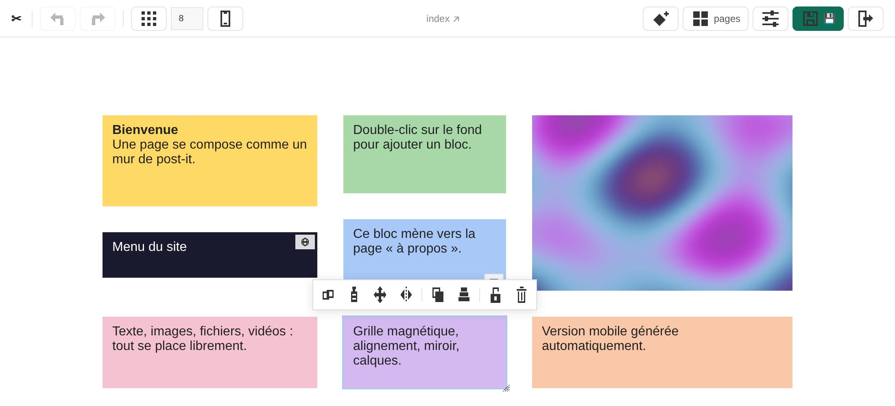

## Pourquoi Scotch ?

Scotch est né d'un besoin simple : disposer d'un outil **léger et immédiat** pour fabriquer des pages web à la main, directement dans le navigateur, sans gabarit imposé ni back-office à apprendre.

Ce besoin, [HotGlue](https://hotglue.me) y répondait très bien. Ce CMS, créé par Gottfried Haider et Danja Vasiliev, repose sur une idée radicale : la page *est* l'éditeur. On pose des éléments où l'on veut, on les déplace, on les redimensionne, et le résultat s'enregistre dans de simples fichiers. Pas de colonnes, pas de modèles, pas de base de données. C'est un outil précieux en atelier, pour des sites d'artistes, des pages événementielles ou des expérimentations.

Scotch reprend cet esprit et l'actualise :

- **compatible PHP 8**, là où HotGlue n’est plus activement maintenu ;
- **une interface en français**, avec des pictogrammes lisibles et une barre d'outils contextuelle ;
- **une version mobile générée automatiquement** à partir de la page libre ;
- **des thèmes**, que l'on peut changer d'un clic sans toucher au contenu ;
- **des données en JSON lisibles**, faciles à sauvegarder, versionner ou réparer à la main.

Scotch n'est pas un fork : le code est réécrit de zéro. Il emprunte à HotGlue sa philosophie, pas ses fichiers.

## Sommaire

- [Installation](#installation)
- [Premiers pas](#premiers-pas)
- [L'interface](#linterface)
- [Thèmes](#thèmes)
- [Raccourcis clavier](#raccourcis-clavier)
- [Structure du projet](#structure-du-projet)
- [Sécurité et mise en production](#sécurité-et-mise-en-production)

## Installation

### Prérequis

- **PHP 8.0 ou plus récent**
- L'extension **GD** (facultative) : elle sert à alléger automatiquement les images téléversées
- **Apache avec `mod_rewrite`** (facultatif) : pour des adresses propres du type `/a-propos`

Aucune base de données, aucun `composer install`, aucun `npm install`.

### Essai rapide, en local

```bash
git clone https://github.com/<ton-compte>/scotch.git
cd scotch
php -S localhost:8000
```

Ouvre ensuite `http://localhost:8000/`. C'est tout.

### Avec XAMPP, MAMP ou WAMP

1. Copie le dossier `scotch/` dans `htdocs/` (ou `www/`).
2. Ouvre `http://localhost/scotch/`.

### Sur un hébergement mutualisé

1. Envoie le dossier par FTP, à la racine du site ou dans un sous-dossier.
2. Vérifie que le dossier `scotch-data/` est accessible en écriture (voir ci-dessous).
3. `mod_rewrite` est activé par défaut chez la plupart des hébergeurs.

### Les deux réglages indispensables

**1. Change le mot de passe.** Ouvre `settings.php` :

```php
define('SCOTCH_LOGIN', 'admin');
define('SCOTCH_PASS',  'changeme');   // ← à remplacer
```

**2. Rends `scotch-data/` accessible en écriture** (Linux, macOS, hébergement) :

```bash
chmod -R 775 scotch-data/
```

C'est dans ce dossier que Scotch enregistre les pages et les fichiers téléversés. Sous Windows avec XAMPP, il n'y a rien à faire.

### Adresses propres (facultatif)

Par défaut, une page s'ouvre avec `?url=nom-de-page`. Le fichier `.htaccess` fourni permet d'écrire simplement `/nom-de-page`, à condition que `mod_rewrite` soit actif et que la configuration Apache autorise les `.htaccess` (`AllowOverride All`). Si Scotch est installé dans un sous-dossier, adapte la ligne `RewriteBase` du `.htaccess`.

## Premiers pas

1. Ajoute **`?edit`** à l'adresse de n'importe quelle page : `http://localhost:8000/?edit`.
2. Connecte-toi avec les identifiants de `settings.php`.

   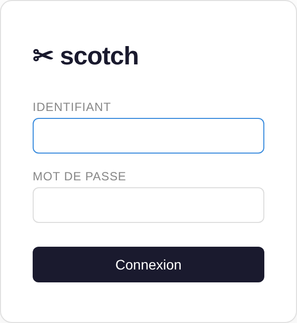

3. **Double-clique sur le fond** de la page pour créer un premier bloc.
4. **Double-clique sur un bloc** pour écrire dedans.
5. Enregistre avec **Ctrl+S**.

Une fois connecté, un bouton « ✎ Modifier » apparaît sur les pages publiques pour revenir à l'éditeur.

## L'interface

### La barre du haut

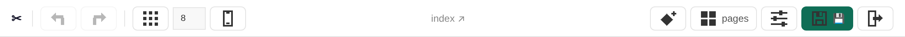

De gauche à droite :

| Bouton | Rôle |
|---|---|
| Flèches | Annuler / rétablir |
| Grille | Active la grille magnétique. Le champ voisin règle son pas en pixels |
| Téléphone | Bascule vers l'aperçu mobile |
| `index ↗` | Nom de la page en cours ; le lien ouvre la version publique dans un nouvel onglet |
| Étincelle | Panneau des animations |
| `pages` | Liste des pages du site |
| Curseurs | Réglages de la page et du site |
| Disquette | Enregistrer |
| Porte | Quitter l'édition (déconnexion) |

### Créer un élément

Un double-clic sur le fond ouvre le menu de création, à l'endroit du clic.

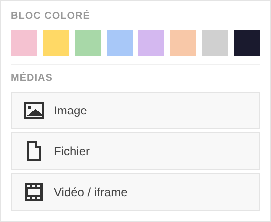

- **Bloc coloré** : un post-it de la couleur choisie, dans lequel on écrit.
- **Image** : téléversée depuis l'ordinateur. Elle peut aussi servir de fond de page (en tuilage ou couvrante).
- **Fichier** : un document à télécharger (PDF, archive…).
- **Vidéo / iframe** : un contenu embarqué depuis une autre plateforme.

Un élément se déplace en le faisant glisser et se redimensionne par son coin inférieur droit.

### La barre contextuelle

Un clic sur un élément le sélectionne et fait apparaître sa barre d'outils.

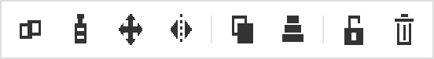

De gauche à droite : **connexions**, **style**, **position et taille**, **miroir**, puis **dupliquer**, **ordre**, et enfin **verrouiller** et **supprimer**.

#### Connexions

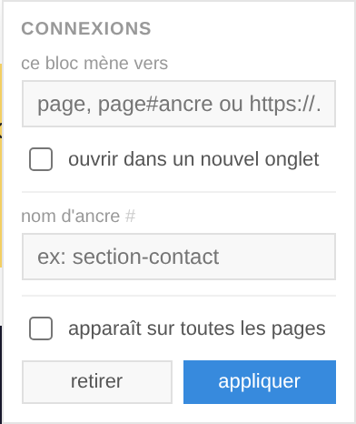

- **Ce bloc mène vers** : transforme le bloc en lien, vers une page du site (proposée pendant la saisie), une ancre (`page#ancre`) ou une adresse externe.
- **Nom d'ancre** : donne un nom au bloc pour pouvoir y pointer depuis un autre lien.
- **Apparaît sur toutes les pages** : rend le bloc *global*. Pratique pour un menu ou un pied de page, que l'on ne compose qu'une fois.

Les blocs liés, ancrés ou globaux portent un petit badge dans l'éditeur.

#### Style

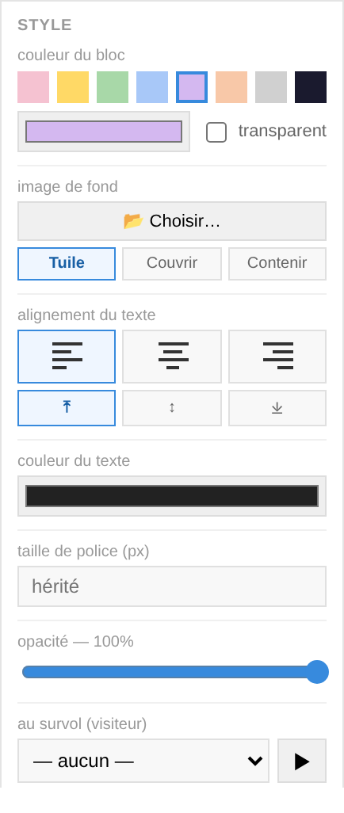

Couleur du bloc (ou fond transparent), image de fond, alignement horizontal et vertical du texte, couleur et taille du texte, police, opacité, et **effet au survol** pour les visiteurs : agrandir, réduire, incliner, inverser, halo ou frétiller.

#### Position et taille

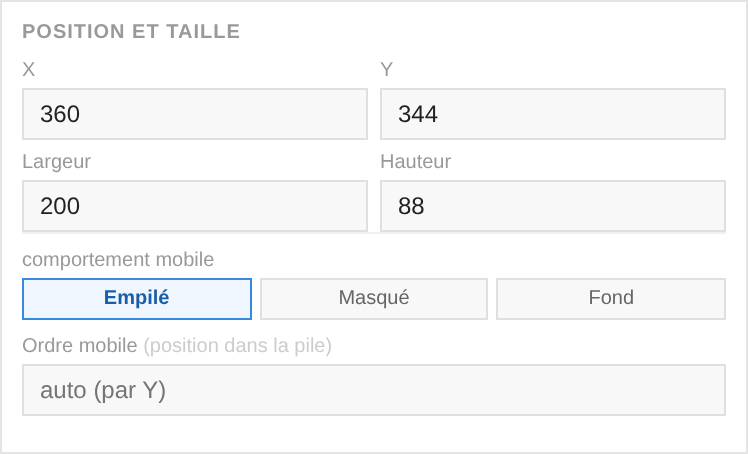

Les coordonnées et dimensions exactes, au pixel près, ainsi que le **comportement sur mobile** de l'élément :

- **Empilé** : il prend sa place dans la colonne ;
- **Masqué** : il n'apparaît pas sur téléphone ;
- **Fond** : il passe en arrière-plan de la page mobile.

Le champ *Ordre mobile* permet de forcer sa position dans la colonne.

#### Miroir et ordre

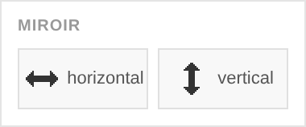 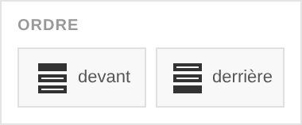

Le miroir retourne l'élément horizontalement ou verticalement. L'ordre le fait passer devant ou derrière ses voisins.

### Sélection multiple et alignement

Maintiens **Maj** en cliquant pour sélectionner plusieurs éléments, ou trace un rectangle de sélection sur le fond. La barre propose alors d'aligner les éléments sur un bord ou un axe, et de les répartir à intervalles réguliers.

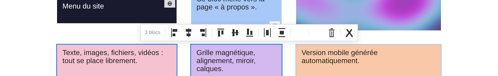

### Le panneau Pages

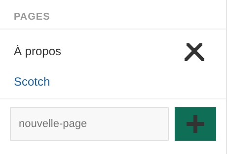

Il liste les pages du site. Saisis un nom en bas pour en créer une nouvelle ; la croix supprime une page. La page d'accueil (`index`) ne peut pas être supprimée.

### Le panneau Réglages

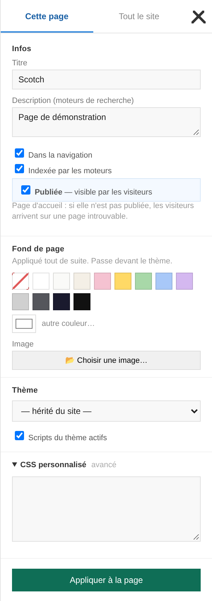

**Pour la page en cours** : titre, description pour les moteurs de recherche, présence dans la navigation, indexation, thème propre à la page, image de fond et CSS personnalisé.

**Pour le site entier** : thème par défaut, CSS et JavaScript communs à toutes les pages, et une option qui laisse les visiteurs choisir eux-mêmes le thème.

**Polices** : ajoute une police Google Fonts en tapant son nom, ou importe un fichier `.woff2`, `.woff`, `.ttf` ou `.otf`. Elle devient disponible dans le menu Style de tous les blocs.

### Le panneau Animations

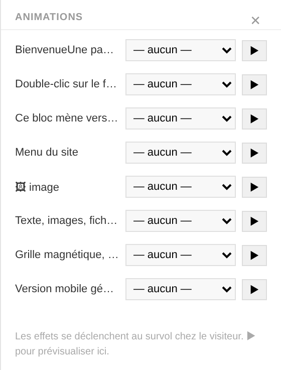

Il rassemble tous les éléments de la page et permet d'attribuer à chacun un effet, avec un bouton pour le prévisualiser.

### L'aperçu mobile

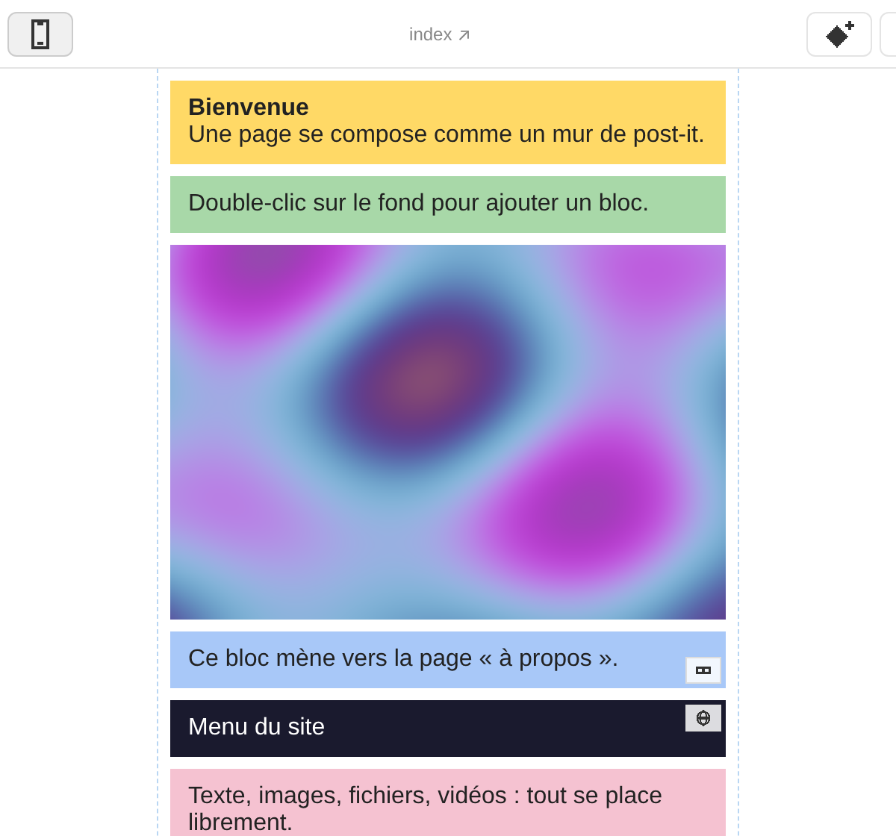

Sur un écran étroit, la mise en page libre devient une colonne : les éléments s'empilent dans l'ordre de lecture et les images s'affichent en entier. Dans cet aperçu, on peut **réordonner les éléments en les faisant glisser**, sans modifier la version pour grand écran.

## Thèmes

Un thème change l'allure de tout le site sans toucher au contenu. Six thèmes graphiques sont fournis.

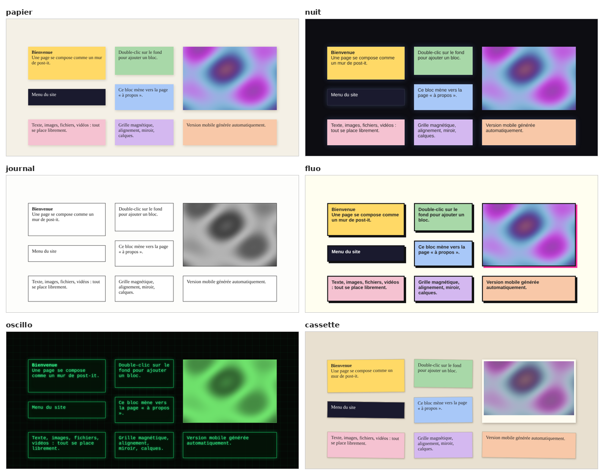

Un thème se choisit dans le panneau Réglages, pour le site entier ou pour une seule page. Chaque thème est un simple fichier CSS dans `scotch-sys/themes/`. Pour en créer un, dépose-y un nouveau fichier `.css` : il apparaît aussitôt dans la liste. Un fichier `.js` du même nom, s'il existe, est chargé avec lui.

### Le thème « modulaire » : un instrument de musique

Le septième thème transforme la page en **synthétiseur modulaire et en instrument de live coding**. Chaque bloc devient un module sonore : on y écrit quelques lignes (`tempo 120`, `play do3 mi3 sol3`…), on relie les blocs avec des câbles, et la page joue. Tout le son est synthétisé dans le navigateur (WebAudio), sans aucun fichier audio.


Il comprend un séquenceur, des percussions analogiques, des effets (écho, réverbe, saturation…), un générateur de mélodies et de rythmes, des animations de blocs qui modulent le son, et le partage d'un morceau par simple lien.

→ Le mode d'emploi complet se trouve dans [docs/live-coding.md](docs/live-coding.md).

## Raccourcis clavier

| Touche | Action |
|---|---|
| `Ctrl+S` | Enregistrer |
| `Ctrl+Z` | Annuler |
| `Ctrl+Y` ou `Ctrl+Maj+Z` | Rétablir |
| `Ctrl+A` | Tout sélectionner |
| `G` | Grille magnétique |
| `M` | Aperçu mobile |
| `Échap` | Désélectionner |
| `Suppr` | Supprimer l'élément sélectionné |
| `↑ ↓ ← →` | Déplacer d'un pixel |
| `Maj + ↑ ↓ ← →` | Déplacer de dix pixels |
| Double-clic sur le fond | Créer un élément |
| Double-clic sur un bloc | Modifier son texte |
| `Maj + clic` | Ajouter à la sélection |

## Structure du projet

```
scotch/
├── settings.php          ← identifiants et configuration
├── index.php             ← routeur et affichage des pages
├── api.php               ← API utilisée par l'éditeur
├── .htaccess             ← adresses propres, protection des données
├── scotch-data/          ← TON CONTENU (à sauvegarder)
│   ├── _site.json        ← réglages du site
│   ├── _global.json      ← blocs présents sur toutes les pages
│   ├── _fonts/           ← polices importées
│   └── index/
│       ├── page.json     ← contenu de la page d'accueil
│       └── files/        ← images et fichiers de cette page
└── scotch-sys/           ← le moteur (inutile d'y toucher)
    ├── css/  js/  pages/
    ├── themes/           ← un fichier .css par thème
    └── ui/               ← pictogrammes de l'éditeur
```

Tout le contenu du site tient dans `scotch-data/`. Pour sauvegarder ou déménager un site, il suffit de copier ce dossier.

## Sécurité et mise en production

- **Change le mot de passe** de `settings.php` avant toute mise en ligne, et ne publie jamais ton vrai mot de passe dans un dépôt public.
- Passe `SCOTCH_DEBUG` à `false` dans `settings.php` pour ne plus afficher les erreurs PHP.
- Le `.htaccess` interdit la lecture directe des fichiers `.json`. Avec un autre serveur qu'Apache (nginx, Caddy…), cette règle est à reproduire dans sa configuration.
- Scotch est pensé pour **une seule personne ou une petite équipe de confiance** : il n'y a qu'un compte, sans gestion de rôles.

## Crédits

Scotch doit son principe à [HotGlue](https://hotglue.me), de Gottfried Haider et Danja Vasiliev.

## Licence

*À préciser.*
